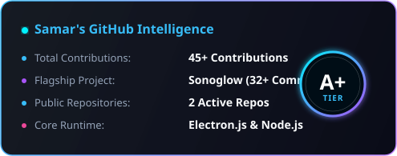
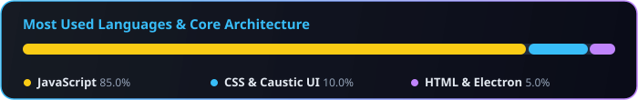

<div align="center">

<!-- 🪐 CUSTOM HIGH-RESOLUTION COSMIC BANNER -->


<br/><br/>

<!-- ✨ DYNAMIC IRIDESCENT TYPING HUD -->


<br/>

<!-- 🫧 GLASS PILL ACTION BADGES -->
<p align="center">
  <a href="mailto:i.axis.019@gmail.com">
    
  </a>
  &nbsp;
  <a href="https://github.com/Samar-019?tab=repositories">
    
  </a>
</p>

<!-- HOLOGRAPHIC LASER BEAM -->


</div>

---

### 💻 Developer Matrix Specification

```typescript
const samarSinghPatel = {
  alias: "Samar-019",
  specialization: "Desktop Applications & Dynamic Visual Audio Systems",
  currentObsession: "Engineering fluid UI/UX with synchronized audio spectrums",
  buildPhilosophy: "Zero compromise on aesthetics; high performance by design",
  coreStack: {
    runtime: ["Electron.js", "Node.js", "Windows APIs"],
    interface: ["JavaScript (ESNext)", "HTML5 Audio/Canvas", "CSS Caustics & Glassmorphism"],
    tooling: ["Git", "GitHub Actions", "VS Code", "Terminal"]
  }
};
```

---

### 🛠️ Arsenal & Technologies

<div align="center">
  
</div>

---

### 📊 Real-Time GitHub Intelligence

<div align="center">

<table border="0" cellspacing="0" cellpadding="0" width="100%">
  <tr>
    <td align="center" width="50%">
      
    </td>
    <td align="center" width="50%">
      
    </td>
  </tr>
  <tr>
    <td colspan="2" align="center">
      <br/>
      
    </td>
  </tr>
</table>

</div>

---

### 🐍 Contribution Grid Stream

<div align="center">
  <picture>
    <source media="(prefers-color-scheme: dark)" srcset="https://raw.githubusercontent.com/Samar-019/Samar-019/output/github-contribution-grid-snake-dark.svg">
    <source media="(prefers-color-scheme: light)" srcset="https://raw.githubusercontent.com/Samar-019/Samar-019/output/github-contribution-grid-snake.svg">
    
  </picture>
</div>

---

<div align="center">

<!-- 💎 ANIMATED PRISM FOOTER WAVE -->


<p align="center">
  <sub>⚡ Designed exclusively for <b>Samar Singh Patel</b> | Building the future of audio software ⚡</sub>
</p>

</div>
