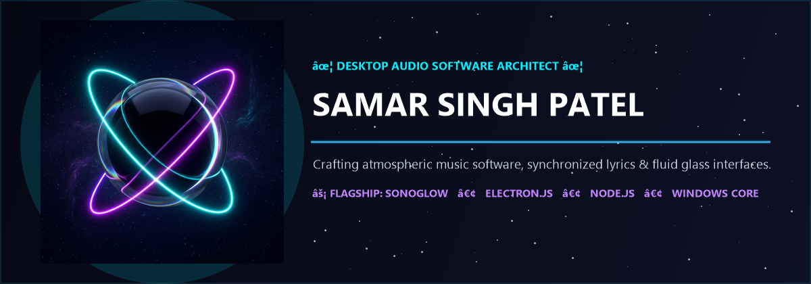

<div align="center">

<!-- 🪐 CUSTOM HIGH-RESOLUTION COSMIC BANNER -->


<br/><br/>

<!-- ✨ DYNAMIC IRIDESCENT TYPING HUD -->
<a href="https://git.io/typing-svg">
  
</a>

<br/>

<!-- 🫧 GLASS PILL ACTION BADGES -->
<p align="center">
  <a href="https://github.com/Samar-019/sonoglow">
    
  </a>
  &nbsp;
  <a href="mailto:i.axis.019@gmail.com">
    
  </a>
  &nbsp;
  <a href="https://github.com/Samar-019?tab=repositories">
    
  </a>
</p>

<!-- HOLOGRAPHIC LASER BEAM -->


</div>

---

### 🚀 Flagship Project: Sonoglow

<div align="center">
  <table>
    <tr>
      <td width="100%" style="background: radial-gradient(circle at top left, #0d1b2a, #060814); border: 1.5px solid #38bdf8; border-radius: 18px; padding: 22px;">
        <h3 align="center">
          <a href="https://github.com/Samar-019/sonoglow">
            <span style="color: #38bdf8; font-size: 24px; font-weight: 800;">⚡ Sonoglow — The Atmospheric Music Experience</span>
          </a>
        </h3>
        <p align="center" style="color: #cbd5e1; font-size: 15px;">
          <i>"Music that becomes part of your desktop — Atmospheric Windows music player with synchronized lyrics and dynamic visuals."</i>
        </p>
        <p align="center">
          
          
          
          
        </p>
        <p align="center">
          <a href="https://github.com/Samar-019/sonoglow">
            
          </a>
          <a href="https://github.com/Samar-019/sonoglow/fork">
            
          </a>
        </p>
      </td>
    </tr>
  </table>
</div>

---

### 💻 Developer Matrix Specification

```typescript
const samarSinghPatel = {
  alias: "Samar-019",
  specialization: "Desktop Applications & Dynamic Visual Audio Systems",
  currentObsession: "Engineering fluid UI/UX with synchronized audio spectrums",
  buildPhilosophy: "Zero compromise on aesthetics; high performance by design",
  coreStack: {
    runtime: ["Electron.js", "Node.js", "Windows APIs"],
    interface: ["JavaScript (ESNext)", "HTML5 Audio/Canvas", "CSS Caustics & Glassmorphism"],
    tooling: ["Git", "GitHub Actions", "VS Code", "Terminal"]
  }
};
```

---

### 🛠️ Arsenal & Technologies

<div align="center">
  
</div>

---

### 📊 Real-Time GitHub Intelligence

<div align="center">

<table border="0" cellspacing="0" cellpadding="0" width="100%">
  <tr>
    <td align="center" width="50%">
      
    </td>
    <td align="center" width="50%">
      
    </td>
  </tr>
  <tr>
    <td colspan="2" align="center">
      <br/>
      
    </td>
  </tr>
</table>

<br/>

<!-- 🏆 CRYSTAL TROPHY BOARD -->
<a href="https://github.com/ryo-ma/github-profile-trophy">
  
</a>

</div>

---

<div align="center">

<!-- 💎 ANIMATED PRISM FOOTER WAVE -->


<p align="center">
  <sub>⚡ Designed exclusively for <b>Samar Singh Patel</b> | Building the future of audio software ⚡</sub>
</p>

</div>
